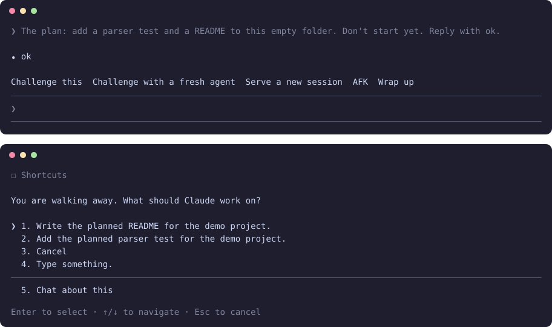

<h1 align="center">claude-dev-shortcuts</h1>

<p align="center"><b>A row of shortcuts above the prompt: talk the plan through until you agree, have an agent council review it, serve it to a new session, walk away, wrap up, and thin out your memory once it has grown.</b></p>

<p align="center">
  
  
  
  
</p>

<p align="center"></p>

<p align="center"><sub>Only this mod enabled, in a real terminal session: the row, then what a press on AFK asks. The offers come from the session.</sub></p>

The things you ask for at the turning points of a session, one click away. Hover over a button to see what it does. Each button asks before it starts, so a misclick costs nothing. The typed commands don't ask.

## Install

In a terminal, inside Claude Code:

```
/plugin install dev-shortcuts --marketplace YlitaloJuha/claude-dev-shortcuts
```

Or from a shell:

```bash
claude plugin install dev-shortcuts --marketplace YlitaloJuha/claude-dev-shortcuts
```

In the desktop app, click + next to the prompt box, then Plugins, Add marketplace with `YlitaloJuha/claude-dev-shortcuts`, then Add plugin.

## What it does

- **Challenge this:** A back-and-forth about the design or idea in this session, in rounds of numbered questions, until your vision and Claude's align and you both agree on the solution. Each question gives the answer it recommends, worded so that "yes" accepts it. Nothing changes while you talk. With words selected, those words are the subject.
- **Agent council:** This session hands its current plan to a fresh agent for review. That agent can spawn up to 4 more agents to verify what the plan rests on. You get what holds, what it got wrong, and the questions only you can answer. With no plan, it says so and stops.
- **Serve a new session:** Writes a handover from this session's plan to `~/.claude/handovers/`, then starts a new top-level session from it. In the desktop app it starts the session itself. In a terminal it gives you one command to run. With no plan, it says so and stops.
- **AFK:** Offers up to three things from this session that Claude could do without you. Pick one or type your own, and it keeps working until the work runs out, a limit is reached, or you type again.
- **Wrap up:** Stops at a suitable moment, verifies, updates the docs, leaves a handoff, then asks before it commits or pushes.
- **Dilute memory:** Appears once this project's memory folder passes 100 KB, or its `MEMORY.md` passes 100 lines or 12.5 KB. It shows a plan and changes nothing until you say yes, then copies the folder to `~/.claude/memory-backups/` before it starts.

AFK stops by itself when the session says it is done, after two turns in a row with no tool use, after 30 turns, at 90% of a plan limit, or on an interrupt or error. Its rules tell it not to commit or push, and it tries to block those commands and any questions.

## Commands

| Command | What it does |
|---|---|
| `/challenge [topic]` | Talk through the topic, the selected words, or the plan in this conversation until you both agree |
| `/council [what to review]` | A fresh agent reviews the plan, using more agents to verify it |
| `/serve [what the next session is for]` | Hand this session's plan to a new top-level session |

AFK, Wrap up and Dilute memory are buttons only.

## What it costs

Each shortcut is normal Claude use and counts against your plan. An agent council also runs its agent and up to 4 more. AFK asks the model once for its offers, then takes up to 30 turns. Serve starts a second session. Measuring the memory folder uses no model.

## What it can reach

No network and no shell commands through the mod API. The mod itself reads one thing: this project's memory folder, to measure it. What a shortcut asks Claude to do runs under your own permission mode. While AFK is on, it refuses `AskUserQuestion` and Bash commands that match `git push`, `git commit`, `git clean`, `git reset --hard`, `gh pr create`, `gh pr merge`, `gh release`, `npm`, `pnpm`, `yarn` or `cargo publish`, and `rm -r` or `rm -f`. Run `claude plugin validate .` in this repository to list every call it makes.

## Limits

- **AFK does not change your permission mode.** In manual mode the session stops at the first permission prompt and waits for you. Choose a mode that allows edits before you leave.
- AFK's command blocks are pattern matches, so a command can be spelled past them. Treat them as a seatbelt, not a sandbox.
- The council agent has Read, Bash and Agent, and the agents it spawns get what you allow them. Their rules say to change nothing, and nothing enforces that but your permission mode.
- **Use it instead of [`claude-afk`](https://github.com/YlitaloJuha/claude-afk) and [`claude-wrap-up`](https://github.com/YlitaloJuha/claude-wrap-up), not beside them.** It holds its own copy of both. With them on too, you get two sets of buttons. [`claude-bars`](https://github.com/YlitaloJuha/claude-bars) works beside it, and does not take over this mod's buttons.
- The buttons wait for an idle session, except Wrap up. AFK and Wrap up appear after the first turn.
- A desktop button has no size settings, so the mod clips each button to shape its hover highlight. The clip hides the keyboard focus ring there.
- A button has no tooltip of its own, so its hover text appears on a line above the row. A terminal shows it only where the pointer reaches Claude Code.
- Tested in real terminal sessions: the row, the question a press asks, Challenge this, `/serve` with no plan to hand over, and the AFK offers. In the desktop app: the row and Wrap up. An agent council, the hover text, serving a real plan, AFK after a pick and a real dilution have only been checked in tests.
- Claude Code draws the band above the prompt only in the terminal and the desktop app, so what this mod draws there does not show in VS Code or on mobile.

## Develop

```bash
claude plugin validate .
claude plugin test .
claude --plugin-dir .
```

## Make it yours

Once it is loaded, ask your own Claude to fit it to how you work, for example to add a shortcut of your own, or change how a challenge runs. The row is in `hooks/register.tsx` and what each shortcut tells Claude is in `hooks/methods.ts`, and the license allows changes. Keep your version in a fork, so an update does not replace it. What you change is yours to check.

## Credits

- Challenge this and Serve started from aihero.dev's [grill-me](https://www.aihero.dev/skills-grill-me) and [handoff](https://www.aihero.dev/skills-handoff) skills, and reuse parts of `grilling` and `handoff` from [mattpocock/skills](https://github.com/mattpocock/skills) by Matt Pocock (MIT), reworded.
- AFK and Wrap up are copies of my own [`claude-afk`](https://github.com/YlitaloJuha/claude-afk) and [`claude-wrap-up`](https://github.com/YlitaloJuha/claude-wrap-up), under the same license.
- The list of prompt origins no person sent comes from [cache-tax](https://github.com/karanb192/cache-tax) by Karan Bansal (MIT).
- The row's icons are from [Lucide](https://lucide.dev) (ISC).
- Dilute memory's limits for `MEMORY.md` follow Anthropic's `consolidate-memory` skill: 200 lines, about 25 KB, each line under about 150 characters. No text from it is used.

## Try other mods together

This mod works on its own, and it also works side by side with my other Claude Code mods. See [the full list on my profile](https://github.com/YlitaloJuha/YlitaloJuha#claude-code-mods).

## License and warranty

[MIT](LICENSE). `THIRD_PARTY_LICENSES.md` covers the parts that came from other projects.

Provided **as is, with no warranty of any kind**. You use it at your own risk, and the author is not liable for anything that results from using it, including lost work, usage charges or changes to your code. AFK acts on your project while nobody is watching, and Dilute memory changes your memory files after you approve its plan, so what they do is yours to check.

**It may break.** It relies on how Claude Code works today, and has been tested on version 2.1.309. It may stop working after a future update if Anthropic changes things.

This is an independent, unofficial project. It is not affiliated with, endorsed by or supported by Anthropic.
